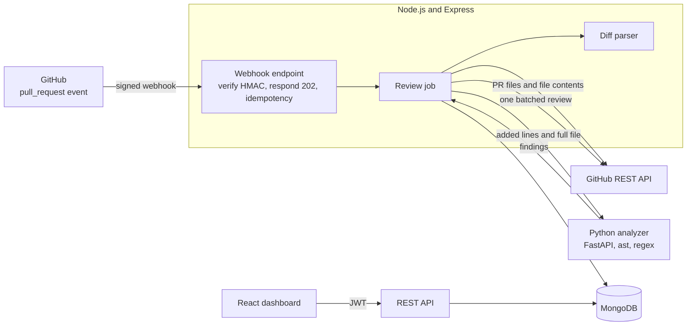

# CodeReviewBuddy

A GitHub App that reviews pull requests automatically. When a PR is opened or updated, it reads only the lines that changed, checks them against a set of rules, and posts **one batched review** with inline comments, like a quiet senior reviewer who never gets tired. A dashboard shows review history, rule statistics and per-repository settings.

Small teams and solo developers do not always have someone to review every pull request. The basic mistakes (a leftover `print`, a bare `except:`, a hardcoded password) slip through. This bot catches them before a human has to.

## What a review looks like

The bot posts a summary on the pull request:

> ### CodeReviewBuddy
> Found 11 new issues in the changed lines: 2 high, 4 medium, 5 low.

and one inline comment per issue, on the exact line:

> 🔴 **High** · `mutable-default`
>
> Mutable default argument is shared between calls. Use None and create the value inside the function.

Push another commit and it only comments on **new** issues. It never repeats itself.

## How it works



1. GitHub sends a `pull_request` webhook. The backend verifies its signature, answers `202` immediately and ignores redeliveries of the same event.
2. A background job lists the PR files, fetches each file at the head commit and parses the unified diff to find **which lines were added** and their real line numbers in the new file.
3. The analyzer (a separate Python service) runs the rules and returns findings. Only findings on added lines are kept.
4. Findings are fingerprinted and compared with the bot's earlier comments, so a new push never repeats an old comment.
5. One review with batched inline comments is posted. Results are stored in MongoDB and shown in the dashboard.

## Rules

| Rule | Applies to | Severity | Catches |
|---|---|---|---|
| `unused-import` | Python | low | An imported name that is never used |
| `bare-except` | Python | medium | `except:` without an exception type |
| `mutable-default` | Python | high | A list, dict or set as a default argument |
| `print-call` | Python | low | A leftover `print` call |
| `long-function` | Python | medium | A function longer than 50 lines |
| `console-log` | JS / TS | low | A leftover `console.log` |
| `var-declaration` | JS / TS | medium | `var` instead of `let` or `const` |
| `loose-equality` | JS / TS | medium | `==` or `!=` (comparing with `null` is allowed) |
| `empty-catch` | JS / TS | medium | A catch block with nothing inside |
| `hardcoded-secret` | any | high | AWS keys, GitHub tokens, private keys, assigned passwords |
| `todo-comment` | any | low | A `TODO` or `FIXME` comment |

Rules can be switched off per repository from the dashboard. Python rules use the standard `ast` module. JavaScript rules are pattern-based (see Limitations).

## Design decisions

- **Only changed lines are reviewed.** A bot that complains about old code is noise. The diff parser follows the hunk header line counts, so a real added line like `++counter` is never confused with a file header.
- **Fingerprints do not contain line numbers.** A fingerprint is a hash of the rule, the file and the trimmed line text, so a finding survives code moving up or down. It is stored as a hidden marker in the comment itself, so de-duplication needs no extra state.
- **Respond fast, work later.** GitHub gives a webhook about 10 seconds. The endpoint verifies, records the delivery and returns `202`; the review runs in the background.
- **Idempotency by delivery id.** `X-GitHub-Delivery` has a unique index, so a redelivery is acknowledged and skipped.
- **Constant-time signature check.** The HMAC is computed over the raw request body and compared with `crypto.timingSafeEqual`.
- **GitHub App, not a personal token.** The backend signs a short-lived RS256 JWT, exchanges it for an installation token, caches it and refreshes it a minute before expiry. Permissions are minimal: pull requests (read and write), contents (read), metadata (read).
- **404 instead of 403.** Asking for another user's repository or run returns "not found", so the API never confirms that it exists.
- **One review, capped.** At most 30 inline comments per review, 50 files and 300 KB of patch per pull request. Whatever is left is reported on the next push, and the summary says so.
- **One source of truth for rules.** The analyzer publishes its rule catalog at `GET /rules`; the dashboard builds the toggle list from it, and a test checks that every catalog entry really fires with the severity it promises.

## Security

- Passwords are hashed with bcrypt. Tokens are JWTs signed with a secret that must be at least 32 characters (the server refuses to start otherwise).
- Every protected route checks ownership, not just "is logged in".
- Inputs are validated on every endpoint, including a guard against operator objects (`{ "$ne": "" }`) in login and query parameters.
- Login and register are rate limited. CORS is limited to the frontend URL.
- Secrets live in environment variables. `.env` and `*.pem` are git-ignored.

## Tech stack

| Part | Technology |
|---|---|
| Backend | Node.js, Express, MongoDB with Mongoose, Octokit, JWT, bcryptjs |
| Analyzer | Python, FastAPI, `ast` |
| Dashboard | React (Vite), Tailwind CSS, React Router |
| Tests | Jest, pytest (300+ tests) |
| Local webhook tunnel | smee.io |

## Project structure

```
codereviewbuddy/
  backend/        Express API, webhook endpoint, review job, GitHub client
    src/routes      webhook, auth, repos, runs, stats, rules
    src/services    diff parser, fingerprints, comment formatter, GitHub App tokens
    src/jobs        review pipeline
    scripts/        seed.js, sendTestWebhook.js
  analyzer/       Python rule engine (one module per language group)
  frontend/       React dashboard
  demo-files/     Small files with intentional issues, for trying the bot
```

## Getting started (Windows, PowerShell)

You need Node.js 18 or newer, Python 3.10 or newer, a free MongoDB Atlas cluster and a GitHub account.

**1. Analyzer**

```powershell
cd analyzer
python -m venv venv
venv\Scripts\activate
pip install -r requirements.txt
uvicorn app.main:app --port 8000
```

**2. Backend** (new terminal)

```powershell
cd backend
npm install
copy .env.example .env
```

Fill in `.env` (see the table below), then:

```powershell
npm run dev
```

**3. Dashboard** (new terminal)

```powershell
cd frontend
npm install
npm run dev
```

Open `http://localhost:5173`.

**4. Try it with demo data**

```powershell
cd backend
npm run seed
```

Sign in with `demo@codereviewbuddy.dev` and `demo-password-123`. This creates two demo repositories with 45 reviews and their findings, so the dashboard is full straight away.

**5. Connect a real repository**

1. On GitHub, create a GitHub App (Settings, Developer settings, GitHub Apps). Turn the webhook on and set the secret to the value of `GITHUB_WEBHOOK_SECRET`. Permissions: Pull requests read and write, Contents read-only, Metadata read-only. Subscribe to the **Pull request** event.
2. Generate a private key, save it as `backend/crb-app.pem`, and put the App ID in `.env`.
3. Install the App on a repository.
4. Forward webhooks to your machine:

```powershell
npx smee-client --url https://smee.io/YOUR-CHANNEL --target http://localhost:4000/webhooks/github
```

Use the smee URL as the App's webhook URL. Open a pull request, for example one that adds the files from `demo-files/`, and the bot reviews it within seconds. Then open the **repos** page in the dashboard and connect the repository to your account.

## Environment variables

| Variable | Used by | Meaning |
|---|---|---|
| `PORT` | backend | Port, default `4000` |
| `MONGODB_URI` | backend | MongoDB connection string |
| `GITHUB_WEBHOOK_SECRET` | backend | Secret used to verify webhook signatures |
| `GITHUB_APP_ID` | backend | Numeric id of the GitHub App |
| `GITHUB_APP_PRIVATE_KEY_PATH` | backend | Path to the App's `.pem` file (or set `GITHUB_APP_PRIVATE_KEY` with the key text) |
| `GITHUB_TOKEN` | backend | Personal access token, only used when `GITHUB_APP_ID` is not set |
| `ANALYZER_URL` | backend | Analyzer address, default `http://localhost:8000` |
| `JWT_SECRET` | backend | At least 32 random characters |
| `FRONTEND_URL` | backend | Allowed CORS origin, default `http://localhost:5173` |
| `VITE_API_URL` | frontend | Backend API address, default `http://localhost:4000/api` |

## API reference

Errors always look like `{ "error": { "message": "..." } }`. List endpoints return `{ items, page, limit, total, totalPages }`.

| Method and path | Auth | Description |
|---|---|---|
| `POST /webhooks/github` | signature | GitHub events (`ping`, `pull_request`) |
| `POST /api/auth/register` | none | Create an account, returns a token |
| `POST /api/auth/login` | none | Sign in, returns a token |
| `GET /api/auth/me` | token | The signed-in user |
| `GET /api/repos` | token | Your repositories |
| `POST /api/repos/claim` | token | Connect a repository the bot has reviewed, body `{ "fullName": "owner/name" }` |
| `PATCH /api/repos/:id/settings` | token | Set `disabledRules` for a repository |
| `GET /api/runs?repo=&page=&limit=` | token | Review history, newest first |
| `GET /api/runs/:id` | token | One run with its findings, most severe first |
| `GET /api/stats/summary?days=&repo=` | token | Reviews, findings, failures and average duration |
| `GET /api/stats/rules?days=&repo=` | token | Findings per rule |
| `GET /api/rules` | token | The rule catalog |

The analyzer exposes `POST /analyze`, `GET /rules` and `GET /health`. A request is `{ files: [{ path, addedLines: [{ line, text }], content }] }` and the response is `{ findings: [{ path, line, ruleId, severity, message }] }`.

## Tests

```powershell
cd backend
npm test

cd ..\analyzer
venv\Scripts\activate
python -m pytest
```

The tests cover the diff parser (hunks, deletions, new files, edge cases), webhook signature verification against the example in GitHub's documentation, idempotency, the review pipeline against a fake GitHub, the GitHub App token cache, every analyzer rule with positive and negative cases, and authorization (one user can never read another user's data).

## Limitations

- **Reviews run inside the web process.** If the server restarts while a review is running, that review is lost. On the next start such runs are marked as failed instead of staying "running" forever. A real queue (BullMQ with Redis) is the proper fix.
- **JavaScript and TypeScript rules are pattern-based**, not parsed. They can miss unusual formatting. Python rules use the real syntax tree.
- **Repository claiming is first come, first served.** Signing in with GitHub (OAuth) would let GitHub confirm who owns a repository.
- **Identical lines share one fingerprint**, so two identical `print("x")` lines produce one comment.
- Reviews are posted as comments only. There are no suggested-change blocks yet.
- GitHub API rate limits are not handled with retries or backoff.
- The unused-import rule does not understand names used only inside string annotations.
- It has been tested on my own repositories, not on a team's real workflow. It is not deployed yet.

## Roadmap

- Job queue with Redis and retries
- Sign in with GitHub, and repositories linked through the App installation
- Tree-sitter for JavaScript and TypeScript rules
- Suggested-change blocks for simple fixes
- Learning from dismissed comments to quiet noisy rules (not built)
- Deployment: frontend on Vercel, backend and analyzer on Render, database on Atlas
